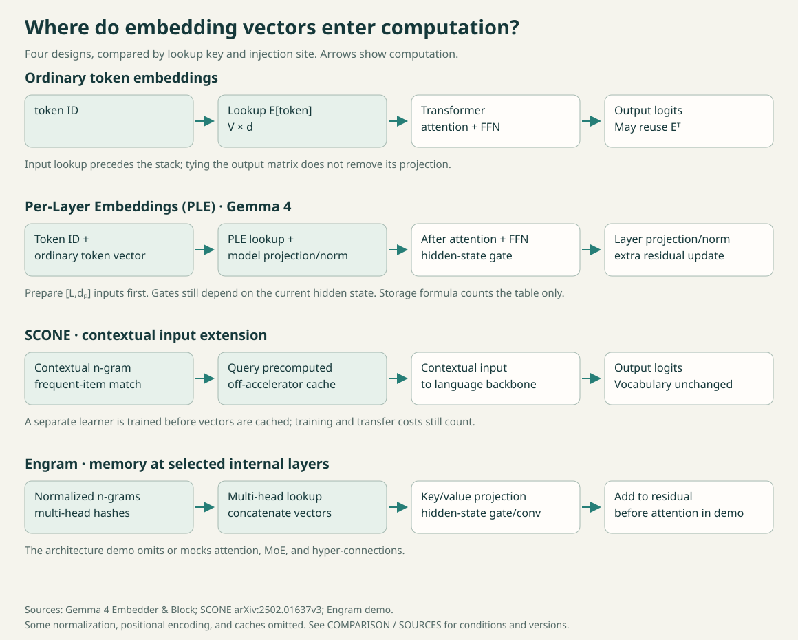

# Awesome Embeddings in Foundation Models

[简体中文](README.zh-CN.md)

How much capacity can an embedding table add, and what does it cost? A guide to token tables, Per-Layer Embeddings (PLE), contextual n-gram lookup, and compression, with comparisons to visual projections and audio codebooks. For researchers and advanced practitioners.

Lookup keys and injection sites across four designs. Follow the wiki for each computation path, or open the figure to zoom.

| Task | Start here |
| --- | --- |
| [Understand PLE](wiki/ple.md) | Follow the table, projection, and gated residual |
| [Compare PLE, SCONE, and Engram](COMPARISON.md) | Check keys, injection sites, and composition evidence |
| [Inspect compression and offloading](wiki/compression.md) | Separate storage, accelerator memory, and latency |

The [reading paths](READING.md) include prerequisites and ordered sources. Save [explorer.html](explorer.html) and open it in your browser to compare theoretical table storage at different vocabulary sizes, dimensions, layer counts, and precisions.

## Selected materials

Papers, tutorials, and implementations, with a reason to read each. File versions are in the [source catalog](SOURCES.md).

| Material | Reader task |
| --- | --- |
| [Using the Output Embedding to Improve Language Models](https://aclanthology.org/E17-2025/) | Understand the shared input/output parameter object and its historical evaluation. |
| [By Tying Embeddings You Are Assuming the Distributional Hypothesis](https://proceedings.mlr.press/v235/bertolotti24a.html) | Read a conditional argument for tying instead of a universal recommendation. |
| [Gemma 3n: PLE caching](https://ai.google.dev/gemma/docs/gemma-3n) | Separate effective parameter load, PLE caching, and modality parameter skipping. |
| [Gemma 4 Embedder and block source](https://github.com/google-deepmind/gemma/blob/main/gemma/gm/nn/gemma4/_modules.py) | Trace lookup, model projection, gating, weight tying, and modality projection. |
| [SCONE: Scaling Embedding Layers in Language Models](https://arxiv.org/html/2502.01637v3) | Compare precomputed contextual n-gram inputs with internal per-layer tables. |
| [Engram official architecture demo](https://github.com/deepseek-ai/Engram/blob/main/engram_demo_v1.py) | Inspect n-gram hashing, multi-head lookup, and hidden-state-dependent fusion. |
| [ALBERT factorized embedding source](https://github.com/google-research/albert/blob/master/modeling.py) | Distinguish vocabulary width from model hidden width in a factorized design. |
| [TensorGPT](https://arxiv.org/html/2307.00526v2) | Compare tensor-train reconstruction with quantization of table values. |
| [OPTIC: compressed PLE with shared token codes](https://github.com/VILA-Lab/optic) | Inspect a PLE-specific codec: shared token codes and per-layer affine decoders. |
| [llm-compressor: input embedding quantization](https://github.com/vllm-project/llm-compressor/blob/main/examples/quantization_embedding/README.md) | Find a concrete nn.Embedding INT4 group-64 recipe and its accounting limits. |
| [Per-Layer Embeddings architecture gallery](https://www.sebastianraschka.com/llm-architecture-gallery/per-layer-embeddings/) | Follow the PLE residual path and the author's request for controlled baselines. |
| [LLMs from Scratch: GPT implementation](https://github.com/rasbt/LLMs-from-scratch/blob/main/ch04/01_main-chapter-code/gpt.py) | Ground token lookup and output-head shape before studying extra memory paths. |
| [TinyEngram systems lab](https://github.com/colorful-lollipop/tinyengram/blob/main/docs/lab7-systems.md) | Reason about touched rows, prefetching, caching, and simulated offload. |
| [SigLIP 2 patch and position embeddings](https://github.com/huggingface/transformers/blob/main/src/transformers/models/siglip2/modeling_siglip2.py) | Identify continuous patch projection separately from a discrete position table. |
| [Mimi codec and Moshi token embeddings](https://github.com/kyutai-labs/moshi) | Separate codec centroids from downstream audio-token embedding tables. |
| [Cosmos Tokenizer: finite scalar quantization](https://github.com/NVIDIA/Cosmos-Tokenizer/blob/main/cosmos_tokenizer/modules/quantizers.py) | See a fixed scalar grid with optional learned projections and a runtime codebook buffer. |
| [Adaptive Input Representations](https://arxiv.org/abs/1809.10853v3) | Compare variable-width vocabulary bands and check the conditions for tying adaptive input/output weights. |

## Research wiki

[Token embeddings and weight tying](wiki/token-embeddings.md) · [Per-Layer Embeddings](wiki/ple.md) · [SCONE and Engram](wiki/ngram-memory.md) · [Embedding compression](wiki/compression.md) · [Visual and modality projections](wiki/visual-projections.md) · [Codec codebooks and LM tables](wiki/audio-codebooks.md)

[Lookup capacity and compute](insights/capacity-and-compute.md) · [The weight-tying trade-off](insights/weight-tying.md)

[Community questions](DEMAND.md) · [Glossary](GLOSSARY.md) · [Contributing](MAINTENANCE.md) · [Updates](UPDATES.md)

Maintained by [Jiacheng Liu](https://github.com/jiachengliu12345). Papers, implementations, and corrections are welcome. Updated 2026-10-27.
