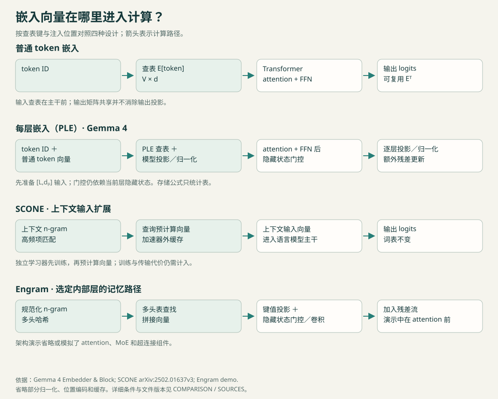

# 基础模型内部嵌入机制精选

[English](README.md)

嵌入表能增加多少容量，代价是什么？这里整理基础模型内部的嵌入机制：token 表、每层嵌入（PLE）、上下文 n-gram 查表与压缩方法，并对照视觉投影和音频码本。面向研究者与进阶实践者。

四种设计的查表键与注入位置。完整计算路径见对应 Wiki；窄屏可打开原图放大。

| 读者任务 | 入口 |
| --- | --- |
| [理解 PLE](wiki/ple.zh-CN.md) | 从表、投影到门控残差 |
| [比较 PLE、SCONE 与 Engram](COMPARISON.zh-CN.md) | 检查键、位置和组合证据 |
| [检查压缩与卸载](wiki/compression.zh-CN.md) | 区分存储、加速器内存和延迟 |

[教程路径](READING.zh-CN.md)提供先修知识与阅读顺序。下载 [explorer.html](explorer.html) 后用浏览器打开，即可调整词表、维度、层数和精度，比较两类表的理论存储量。

## 精选材料

论文、教程与实现，按阅读用途推荐。具体版本见[材料清单](SOURCES.zh-CN.md)。

| 材料 | 读者用途 |
| --- | --- |
| [输入输出权重共享：早期实验](https://aclanthology.org/E17-2025/) | 理解输入输出共用的参数对象及早期评测。 |
| [权重共享与分布假设](https://proceedings.mlr.press/v235/bertolotti24a.html) | 阅读带适用条件的权重共享论证。 |
| [Gemma 3n：PLE 缓存](https://ai.google.dev/gemma/docs/gemma-3n) | 区分有效参数载入量、PLE 缓存和模态参数跳过。 |
| [Gemma 4 嵌入与 block 源码](https://github.com/google-deepmind/gemma/blob/main/gemma/gm/nn/gemma4/_modules.py) | 追踪查表、模型投影、门控、权重共享和模态投影。 |
| [SCONE：语言模型嵌入层扩展](https://arxiv.org/html/2502.01637v3) | 比较预计算上下文 n-gram 输入与模型内部每层表。 |
| [Engram 官方架构演示](https://github.com/deepseek-ai/Engram/blob/main/engram_demo_v1.py) | 检查 n-gram 哈希、多头查表与依赖隐藏状态的融合。 |
| [ALBERT 分解式嵌入源码](https://github.com/google-research/albert/blob/master/modeling.py) | 在分解设计中区分词表嵌入维度与模型隐藏维度。 |
| [TensorGPT：张量列嵌入压缩](https://arxiv.org/html/2307.00526v2) | 比较张量列重建与表值量化。 |
| [OPTIC：共享 token 编码的 PLE 压缩](https://github.com/VILA-Lab/optic) | 检查面向 PLE 的压缩：token 共享编码和每层仿射解码器。 |
| [llm-compressor：输入嵌入量化](https://github.com/vllm-project/llm-compressor/blob/main/examples/quantization_embedding/README.md) | 找到针对 nn.Embedding 的 INT4、组大小 64 配方及计量边界。 |
| [每层嵌入架构解读](https://www.sebastianraschka.com/llm-architecture-gallery/per-layer-embeddings/) | 理解 PLE 残差路径与作者提出的受控基线问题。 |
| [从零实现语言模型：GPT 代码](https://github.com/rasbt/LLMs-from-scratch/blob/main/ch04/01_main-chapter-code/gpt.py) | 先理解 token 查表与输出头形状，再读额外记忆路径。 |
| [TinyEngram 系统实验课](https://github.com/colorful-lollipop/tinyengram/blob/main/docs/lab7-systems.md) | 分析访问行、预取、缓存与卸载模拟。 |
| [SigLIP 2 图像块投影与位置嵌入](https://github.com/huggingface/transformers/blob/main/src/transformers/models/siglip2/modeling_siglip2.py) | 区分连续图像块投影与离散位置嵌入表。 |
| [Mimi codec 与 Moshi token 嵌入](https://github.com/kyutai-labs/moshi) | 区分 codec 码本中心与下游音频 token 嵌入表。 |
| [Cosmos Tokenizer：有限标量量化](https://github.com/NVIDIA/Cosmos-Tokenizer/blob/main/cosmos_tokenizer/modules/quantizers.py) | 理解固定标量网格、可选学习投影与运行时码本缓冲区。 |
| [自适应输入表示](https://arxiv.org/abs/1809.10853v3) | 比较不同维度的词表分组，并检查自适应输入输出权重共享的条件。 |

## 研究 Wiki

[token 嵌入与权重共享](wiki/token-embeddings.zh-CN.md) · [每层嵌入](wiki/ple.zh-CN.md) · [SCONE 与 Engram](wiki/ngram-memory.zh-CN.md) · [嵌入压缩](wiki/compression.zh-CN.md) · [视觉与模态投影](wiki/visual-projections.zh-CN.md) · [codec 码本与 LM 表](wiki/audio-codebooks.zh-CN.md)

[查表容量与计算](insights/capacity-and-compute.zh-CN.md) · [权重共享的取舍](insights/weight-tying.zh-CN.md)

[社区问题](DEMAND.zh-CN.md) · [术语表](GLOSSARY.zh-CN.md) · [参与贡献](MAINTENANCE.zh-CN.md) · [更新记录](UPDATES.zh-CN.md)

由 [Jiacheng Liu](https://github.com/jiachengliu12345) 维护。欢迎补充论文、实现和勘误。更新于 2026-10-27。
