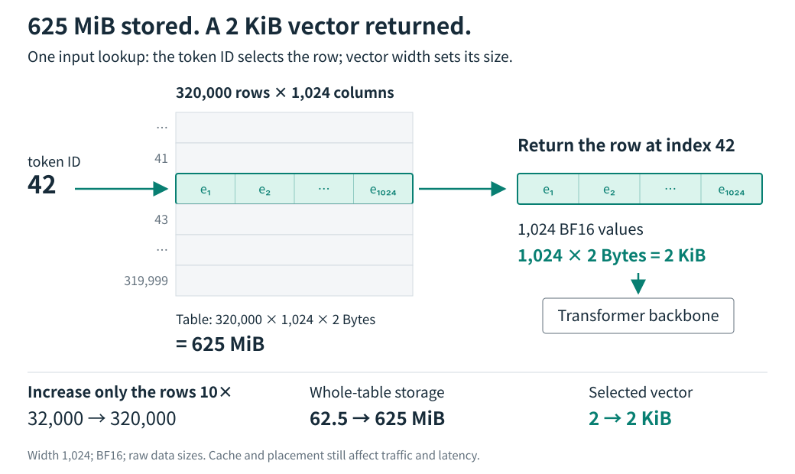

<!-- topic: token -->
<!-- sources: weight-tying,gemma4 -->

# Token embeddings

[简体中文](token-embeddings.zh-CN.md) · [README](../README.md) · [Comparison](../COMPARISON.md) · [Sources](../SOURCES.md)

## Embedding tables and lookup

A token embedding table maps each token ID to a learned vector. For vocabulary size $V$ and hidden width $d$, write the table as $E\in\mathbb{R}^{V\times d}$. Given token $t_i$ at sequence position $i$, the model reads one row:

$$
x_i=E[t_i].
$$

The tokenizer converts text to token IDs; the embedding table converts those IDs to model input vectors.

## Input/output weight tying

Gemma 4's `Embedder` provides an implementation example. `encode` indexes `input_embedding_table` and scales the result by $\sqrt{d}$. `decode` multiplies each final hidden vector $h_i$ at position $i$ by the transpose of that same table to produce next-token logits. When input and output weights are tied, the model reuses $E$ for both paths:

$$
\text{logits}_i=h_iE^\top.
$$

Weight tying saves a second vocabulary-sized parameter matrix. The output path still uses a matrix multiplication to score candidate next tokens. The [weight-tying research note](../insights/weight-tying.md) covers studies of shared and separate representations.

## Storage and access

Let $b$ be the number of bits per value. The table's raw vector data uses approximately $Vdb/8$ bytes; this estimate excludes indexes and other metadata. A tied input/output table keeps one copy of those weights. Optimizer states, temporary buffers, quantization scales, padding, and sharding can add storage beyond this estimate. The table is addressed by token ID and normally loaded with model parameters. Moving it to host memory changes transfer and caching requirements; it does not change the mapping itself.

<picture>
  <source media="(max-width: 600px)" srcset="../assets/lookup-story.mobile.en.svg">
  
</picture>

For example, a BF16 table with 320,000 rows and width 1,024 holds 625 MiB of raw weights; a single input lookup returns a 2 KiB row. The figure varies row count at fixed width and precision to show the relation between table capacity and row size.

Token embeddings also set the scale of downstream parameterization. Increasing $V$ grows the input table and, when weights are tied, still increases the output vocabulary projection. Rare new rows may receive few training updates.

## Implementation reference

In the [Gemma 4 implementation](https://github.com/google-deepmind/gemma/blob/main/gemma/gm/nn/gemma4/_modules.py), inspect `Embedder.setup`, `encode`, and `decode`. Confirm the table shape, the row lookup, the scale, and whether decode uses the same parameter. Then inspect the checkpoint configuration and tensor index. A missing `lm_head.weight` entry can mean that the output head shares storage with the input table; the index alone does not prove that the output head is absent.

Related topics: [PLE](ple.md) describes token-indexed vectors at each layer; [n-gram memory](ngram-memory.md) describes lookup keys formed from neighboring tokens.
