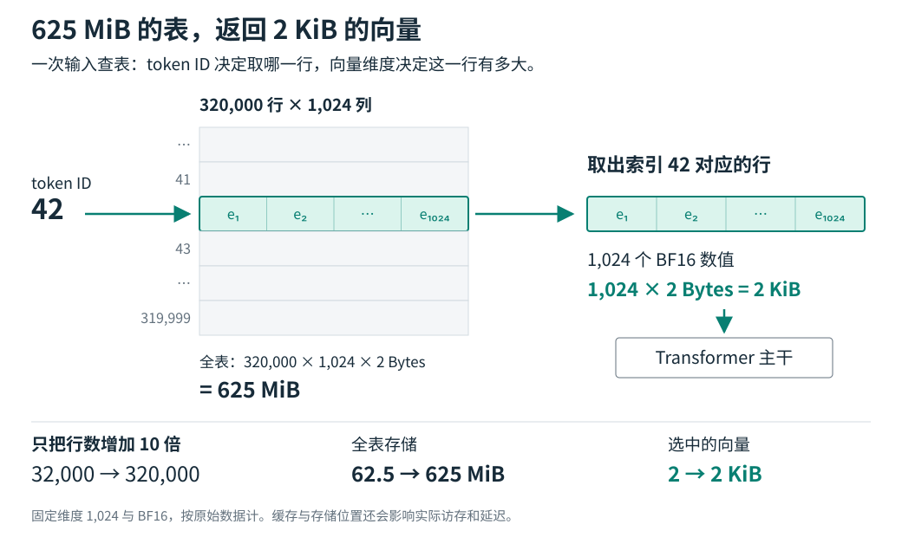

<!-- topic: token -->
<!-- sources: weight-tying,gemma4 -->

# Token 嵌入

[English](token-embeddings.md) · [README](../README.zh-CN.md) · [比较](../COMPARISON.zh-CN.md) · [来源](../SOURCES.zh-CN.md)

## 嵌入表与查表

token 嵌入表把 token ID 映射为训练得到的向量。词表大小为 $V$、隐藏维度为 $d$ 时，可将表记为 $E\in\mathbb{R}^{V\times d}$。给定 token $t_i$，模型读取对应行：

$$
x_i=E[t_i].
$$

Tokenizer 将文本转换为 token ID，嵌入表再将这些 ID 转换为模型使用的输入向量。

## 输入输出权重共享

Gemma 4 的 `Embedder` 提供了一个实现例子。`encode` 按 token ID 查 `input_embedding_table`，再乘以 $\sqrt{d}$；`decode` 用位置 $i$ 上的最终隐藏向量 $h_i$ 乘以同一张表的转置，得到下一个 token 的 logits。输入和输出权重绑定（weight tying）时，模型在两个位置复用 $E$：

$$
\text{logits}_i=h_iE^\top.
$$

权重共享省去第二张按词表大小分配的参数矩阵。输出端仍通过矩阵乘法为候选下一个 token 计算分数。共享和独立参数两种设计的研究背景见[权重共享的取舍](../insights/weight-tying.zh-CN.md)。

## 存储与访问

令 $b$ 表示每个值占用的位数。仅计算向量原始数据时，稠密表约占 $Vdb/8$ 字节；该估算不含索引和其他元数据。绑定输入和输出权重后只保留一份表。优化器状态、临时缓冲区、量化比例、对齐和分片会在此估算之外增加存储。模型通常按 token ID 查行并加载参数。把表放到主机内存会带来传输和缓存条件，但不改变映射关系。

<picture>
  <source media="(max-width: 600px)" srcset="../assets/lookup-story.mobile.zh-CN.svg">
  
</picture>

例如，320,000 行、每行 1,024 维的 BF16 表，其原始权重占 625 MiB；一次输入查表返回的一行占 2 KiB。图中固定维度和精度，只改变行数，以说明表的容量与单行大小的关系。

token 嵌入也影响后续参数化。增大 $V$ 会扩大输入表；若输入输出绑定，还会扩大输出词表投影。新表中的稀有 token 行可能很少得到训练更新。

## 实现参考

在 [Gemma 4 实现](https://github.com/google-deepmind/gemma/blob/main/gemma/gm/nn/gemma4/_modules.py)中查看 `Embedder.setup`、`encode` 和 `decode`：确认表形状、按行查找、缩放方式，以及解码是否使用同一参数。再检查检查点配置和张量索引。若索引中没有 `lm_head.weight`，可能是输出头与输入表共享存储；单看索引不能证明输出头不存在。

相关主题：[每层嵌入（PLE）](ple.zh-CN.md)介绍逐层的 token 向量；[n-gram 记忆](ngram-memory.zh-CN.md)介绍由相邻 token 组成的查找键。
