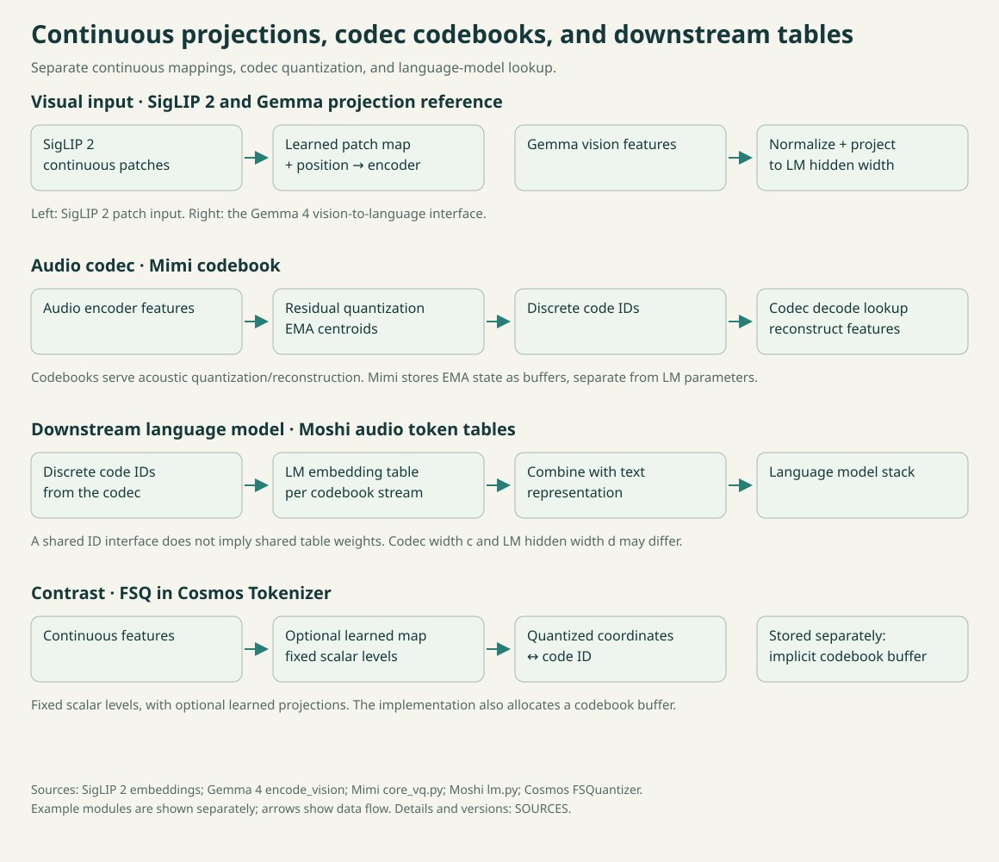

<!-- topic: visual-projections -->
<!-- sources: siglip2,gemma4 -->

# Visual inputs and modality projections

[简体中文](visual-projections.zh-CN.md) · [Sources](../SOURCES.md) · [Comparison](../COMPARISON.md)

A visual input first becomes patch representations for a vision encoder. A multimodal language model can then project those representations to its own hidden width. This page covers patch projection and vision-to-language projection; here, a projection is a learned linear mapping.

*SigLIP 2 patch projection and Gemma 4 vision-to-language projection are shown as separate paths.*

## SigLIP 2: patch and position embeddings

In the inspected Hugging Face SigLIP 2 implementation, inputs have already been divided into patches and flattened. `Siglip2VisionEmbeddings` applies an `nn.Linear` from $C \times P \times P$ values to the vision hidden width. It then adds a learned positional embedding selected by patch position. The implementation resizes those position embeddings for the input's spatial shape and pads to the requested sequence length. Patch projection computes content from pixel values; positional lookup contributes location information. They are separate parameter objects and operations.

The patch projection multiplies each patch vector by a learned matrix, so work grows with patch count and input dimensions. The positional table scales with its grid; interpolation and padding add runtime work. Higher image resolution can produce more patches and encoder work.

## Gemma 4: vision-to-language projection

Gemma 4's `encode_vision` applies `mm_pre_projection_norm` with `with_scale=False`, then `mm_input_projection` from `vision_proj_dim` to `embed_dim`. This lets a visual representation enter the language model's token space. The vector is computed by a vision encoder and then transformed; it is not selected by a token ID from a learned vocabulary table. The projection adds learned weights; normalization adds arithmetic without a learned scale in this path. This method is distinct from PLE, which supplies token-indexed, layer-specific vectors inside decoder layers.

## Parameters and compute

Input and output widths determine the projection matrix size; patch count determines how often it is applied. Image resolution and cropping also change the sequence length processed by the vision encoder. Adapter costs therefore need to be compared alongside the encoder, resolution, and downstream architecture.

The [comparison](../COMPARISON.md) separates lookup tables, projections, and decoder injection. Source IDs: `siglip2`, `gemma4` in [SOURCES.md](../SOURCES.md).
